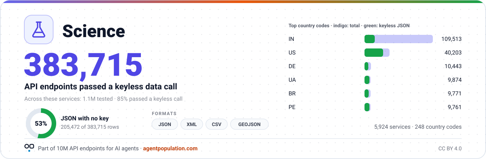
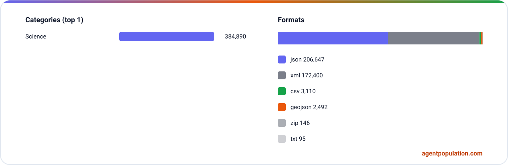

<p align="center"></p>

# 🔬 Science API endpoints

**384,890 science API endpoints that answered a keyless GET with a data body. For agent and app builders.**

<p align="center"><a href="#files"></a> <a href="#columns-and-tags"></a> <a href="#whats-inside"></a> <a href="#whats-inside"></a> <a href="LICENSE"></a></p>

<p align="center"><a href="#whats-in-it-for-you">What's in it</a> · <a href="#for-ai-agents">For AI agents</a> · <a href="#quick-start">Quick start</a> · <a href="#test-it-yourself">Test it yourself</a> · <a href="#files">Files</a> · <a href="#licence-and-credit">Licence</a> · <a href="#part-of-10m-api-endpoints-for-ai-agents">More packs</a></p>

This repository holds a 1,000-row sample and the services list; the full list of 384,890 endpoints is one download from the [latest release](https://github.com/agentpopulation/380k-science-apis-for-agents/releases/latest).

**Endpoints for building a science lookup or research assistant.** Geological model and map layers (most from the Flemish subsurface service), sunrise and sunset times for cities, space-weather, satellite and launch feeds, biodiversity dataset searches and research-project files, as URLs that answered with no key on their test date.

Selection rule: rows where `category is "Science"`, less the rows that a leave-out rule drops (each counted under Known limits).

102,756 of these 384,890 rows match the focus rule (below); the others are in the pack by the selection rule only, and Known limits says what they are.

## In plain words

**What is an API endpoint?** An API endpoint is one web address that a program can ask for data, for example the latest reading at one weather station. A single service, such as a national weather agency, can have thousands of endpoints: one per station, city or dataset. This pack counts endpoints, not separate services.

**What does "passed a data call" mean?** On the date shown in each row, AgentPopulation sent one plain request to that address, with no password or key, and got a non-empty data body back (JSON, CSV, XML or a file): not an error page and not an empty result. Some bodies describe a dataset rather than hold its values; see Known limits. It shows the address answered with data on that day. It is not a promise that it answers today, and licences and usage limits were not reviewed.

## What's in it for you

Four ways to use this pack. Each bucket gives a count, a filter you can apply to the CSV, one example that passed, and a list of recommended starting points with the rule that picked them. Buckets overlap; a row can fit more than one.

Examples, recommended lists and the preview are drawn from rows that match this pack's focus rule, so a row that the selection rule put in this pack but that is about something else is not shown as a starting point. Counts cover the whole bucket.

<details>
<summary>The focus rule</summary>

Focus rule: `(title or subcategory matches /geolog|geologic|bedrock|surficial|borehole|drill|stratigra|lithol|mineral|\brocks\b|rock types?|fault|fossil|quaternary|sediment|geophys|gravity|magnet|seism|isopach|isohyps|\bformations?\b|\bfm\b|aquifer|karst|cave|geosite|geotop|geomorph|tectonic|ondergrond|boring|grondwater|geologi|geología|geologia|geologie|bodem|soil/i OR title matches /sunrise|sunset|satellit|space weather|space station|spacecraft|orbit|\btle\b|\biss\b|launch|astronom|planetary|eonet|\bstac\b|research|scien|wissenschaft|r&d|biodivers|gbif|species|genom|laborator|experiment|cordis|patent|physics|replication data/i OR subcategory matches /^Sun times|satellite/space|GBIF|· (research|science|scientific|satellite)$/i OR url matches /www\.dov\.vlaanderen\.be//i) AND NOT title or subcategory matches /wifi|wi-fi|\bict\b|internet|digital (nodes|facilitation|divide|skills|technolog)|digitale\b|digitalisation|facilitazione digitale|broadband|telecom|\bozg\b|cso services|freifunk|router|development plan|xplanung|bebauungsplan|building model|commerce|salary|complaints|organic (farm|production|operator)|gastronom|restaurant|study programme|authorisations for study|for research and study|limewire/i AND NOT subcategory matches /· (schools|libraries|substations|pipelines)$/i AND NOT (subcategory matches /· (astronom|genom)$/i AND NOT title matches /astronom|genom|\bgenes?\b|genetic/i)`

</details>

### 🤖 Agent tools: Sun times, space, satellite and biodiversity lookups an agent can call

**2,870** endpoints from 19 services · Wrap one sun-times URL as a get_sun_times tool: pass a latitude and longitude, return sunrise, sunset and day length; add space-weather and GBIF lookups as separate tools with a timeout.

2,749 of these are sunrise and sunset queries for one city each; change lat and lng (or lon) in the URL for any other place.

Start with: `tags has agent-ready AND subcategory matches /^Sun times|satellite/space|GBIF/i`

Example: [Sunrise/sunset: Kisumu, Kenya](https://api.sunrise-sunset.org/json?lat=-0.102&lng=34.762&formatted=0) · Sunrise-Sunset.org · passed 2026-11-14

<details>
<summary>Recommended starting points: 8 services, picked by the stated criteria inside</summary>

**Recommended starting points.** Selected by stated criteria, not a ranking of quality: Services in this pack with the most endpoints that match this bucket and are tagged `agent-ready` (no key sent in the test call, JSON body, passed a data call). Ties go to the service with more country codes, then by name. Only services with at least one bucket row that matches the focus rule are listed, and the sample comes from those rows; the counts cover the whole bucket. The sample URL is the first row by URL sort after preferring, in this order: rows that match the bucket's sample preference when it has one, rows that return values rather than describe a dataset or a service (not ERDDAP /info/ pages, OGC GetCapabilities requests, bare OWS addresses, PxWeb tables, UN SDG series lists, Statistics Canada download pointers, WorldPop listings, GTFS validation reports, untitled rows or service root addresses), and agent-ready rows. Sample preference in this bucket: `url matches /sunrise-sunset\.org/json\?lat=|/sunrise/3\.0/sun\?lat=|publishingCountry=|planetary-k-index|gp\.php\?GROUP=|events\?status=|launches/upcoming|satellites/\?format=/i`. Services named "ArcGIS organization" hold map layers from many owners and are added only when fewer than 5 other services match.

| Service (host) | Endpoints in bucket | In pack | Country codes in bucket | Formats in bucket | Sample URL that passed |
|---|---:|---:|---|---|---|
| Sunrise-Sunset.org (api.sunrise-sunset.org) | 1,478 | 1,478 | 242 codes | json | [Sunrise/sunset: Kisumu, Kenya](https://api.sunrise-sunset.org/json?lat=-0.102&lng=34.762&formatted=0) (2026-11-14) |
| MET Norway (api.met.no) | 1,271 | 1,271 | 186 codes | json | [Sunrise/sunset times: Kisumu, Kenya](https://api.met.no/weatherapi/sunrise/3.0/sun?lat=-0.102&lon=34.762) (2026-11-14) |
| GBIF (Global Biodiversity Information Facility) (api.gbif.org) | 100 | 100 | 100 codes | json | [GBIF datasets published in Andorra](https://api.gbif.org/v1/dataset/search?publishingCountry=AD&limit=50) (2026-11-14) |
| Nasa (eonet.gsfc.nasa.gov) | 2 | 2 | US | json | [NASA EONET natural events](https://eonet.gsfc.nasa.gov/api/v3/events?status=open&limit=1) (2026-11-10) |
| Noaa (services.swpc.noaa.gov) | 2 | 2 | US | json | [NOAA SWPC space weather JSON](https://services.swpc.noaa.gov/products/noaa-planetary-k-index.json) (2026-11-10) |
| Microsoft Planetary Computer (planetarycomputer.microsoft.com) | 2 | 264 | global or unknown | json | [Microsoft Planetary Computer STAC](https://planetarycomputer.microsoft.com/api/stac/v1/collections) (2026-11-10) |
| SatNOGS DB & Network API (db.satnogs.org) | 2 | 2 | global or unknown | json | [SatNOGS DB API](https://db.satnogs.org/api/satellites/?format=json&norad_cat_id=25544) (2026-11-10) |
| The Space Devs Launch Library 2 (LL2) (ll.thespacedevs.com) | 2 | 2 | global or unknown | json | [Launch Library 2 (The Space Devs)](https://ll.thespacedevs.com/2.3.0/launches/upcoming/?limit=1) (2026-11-10) |

</details>

### 📱 App features: Geology maps: bedrock, surficial deposits, boreholes and geological model layers

**12,574** endpoints from 1,047 services · Show the geology under a place on a map: load a bedrock or surficial layer for one area and return unit name, age and rock type for a clicked point.

5,220 of these come from the Flemish subsurface service (dov.vlaanderen.be): geological model layers as WFS feature requests or KML exports.

Start with: `title or subcategory matches /geolog|geologic|bedrock|surficial|borehole|drill|stratigra|lithol|mineral|\brocks\b|rock types?|fault|fossil|quaternary|sediment|geophys|gravity|magnet|seism|isopach|isohyps|\bformations?\b|\bfm\b|aquifer|karst|cave|geosite|geotop|geomorph|tectonic|ondergrond|boring|grondwater|geologi|geología|geologia|geologie|bodem|soil/i OR url matches /www\.dov\.vlaanderen\.be//i`

Example: [INSPIRE harmonized - Drill hole measurements](https://www.dov.vlaanderen.be/geoserver-inspire/boreholelogging/wfs?SERVICE=WFS&version=2.0.0&request=GetFeature&count=1&typeName=boreholeLogging) · DOV Flanders subsoil / water · passed 2026-11-14

<details>
<summary>Recommended starting points: 8 services, picked by the stated criteria inside</summary>

**Recommended starting points.** Selected by stated criteria, not a ranking of quality: Services in this pack with the most endpoints that match this bucket and passed a data call. Ties go to the service with more country codes, then by name. Only services with at least one bucket row that matches the focus rule are listed, and the sample comes from those rows; the counts cover the whole bucket. The sample URL is the first row by URL sort after preferring, in this order: rows that match the bucket's sample preference when it has one, rows that return values rather than describe a dataset or a service (not ERDDAP /info/ pages, OGC GetCapabilities requests, bare OWS addresses, PxWeb tables, UN SDG series lists, Statistics Canada download pointers, WorldPop listings, GTFS validation reports, untitled rows or service root addresses), and agent-ready rows. Sample preference in this bucket: `title matches /geolog|bedrock|surficial|borehole|drill|fault/i AND NOT url matches ///(services[0-9]*(-[a-z0-9]+)?|utility)\.arcgis\.com//i`. Services named "ArcGIS organization" hold map layers from many owners and are added only when fewer than 5 other services match.

| Service (host) | Endpoints in bucket | In pack | Country codes in bucket | Formats in bucket | Sample URL that passed |
|---|---:|---:|---|---|---|
| DOV Flanders subsoil / water (www.dov.vlaanderen.be) | 5,220 | 5,220 | BE | xml | [INSPIRE harmonized - Drill hole measure…](https://www.dov.vlaanderen.be/geoserver-inspire/boreholelogging/wfs?SERVICE=WFS&version=2.0.0&request=GetFeature&count=1&typeName=boreholeLogging) (2026-11-14) |
| Genenames (rest.genenames.org) | 1,000 | 1,000 | GB | json | [HUGO Gene Nomenclature Committee (HGNC)…](https://rest.genenames.org/fetch/hgnc_id/10522) (2026-11-15) |
| US West 2 (AWS) (asc-jupiter.s3.us-west-2.amazonaws.com) | 663 | 663 | global or unknown | json | [USGS Astrogeology Provided Analysis Rea…](https://asc-jupiter.s3.us-west-2.amazonaws.com/catalog.json) (2026-11-15) |
| US West 2 (AWS) (asc-mars.s3.us-west-2.amazonaws.com) | 474 | 474 | global or unknown | json | [USGS Astrogeology Provided Analysis Rea…](https://asc-mars.s3.us-west-2.amazonaws.com/catalog.json) (2026-11-15) |
| Usgs (data.usgs.gov) | 337 | 471 | US | xml | [Structural Geology of the Mosier Creek …](https://data.usgs.gov/datacatalog/metadata/USGS.08212a9c-8c6c-4e5e-8bff-71e8dc9eeee7.xml) (2026-11-15) |
| Canadian Urban Data Catalogue (CUDC) (geodiscover.alberta.ca) | 334 | 361 | CA | xml | [Surficial Geology, Alberta Foothills an…](https://geodiscover.alberta.ca/geoportal/rest/metadata/item/07e6ff10ce284b74bd384f89cbba96d3/xml) (2026-11-15) |
| Admin (data.geo.admin.ch) | 120 | 959 | CH | geojson, json | [data.geo.admin.ch (STAC API data.geo.ad…](https://data.geo.admin.ch/api/stac/v1/collections/ch.agroscope.abschaetzung-organische_boeden) (2026-11-15) |
| Journalijpss (journalijpss.com) | 118 | 118 | IN | xml | [International Journal of Plant & Soil S…](https://journalijpss.com/index.php/index/oai?verb=GetRecord&metadataPrefix=oai_dc&identifier=oai:ojs.pkp.sfu.ca:article/1) (2026-11-15) |

</details>

### 🧠 Grounding and data pipelines: Research projects, biodiversity datasets and science statistics for scheduled loads

**54,693** endpoints from 1,404 services · Load research-project lists, R&D statistics and biodiversity dataset searches on a schedule into your own store, so answers about who studies what cite a dated source.

Start with: `title matches /research|scien|wissenschaft|r&d|patent|cordis|biodivers|gbif|genom|experiment|physics|replication data/i OR subcategory matches /· (research|science|scientific)$|GBIF/i`

Example: [GBIF datasets published in Andorra](https://api.gbif.org/v1/dataset/search?publishingCountry=AD&limit=50) · GBIF (Global Biodiversity Information Facility) · passed 2026-11-14

<details>
<summary>Recommended starting points: 8 services, picked by the stated criteria inside</summary>

**Recommended starting points.** Selected by stated criteria, not a ranking of quality: Services in this pack with the most endpoints that match this bucket and passed a data call. Ties go to the service with more country codes, then by name. Only services with at least one bucket row that matches the focus rule are listed, and the sample comes from those rows; the counts cover the whole bucket. The sample URL is the first row by URL sort after preferring, in this order: rows that match the bucket's sample preference when it has one, rows that return values rather than describe a dataset or a service (not ERDDAP /info/ pages, OGC GetCapabilities requests, bare OWS addresses, PxWeb tables, UN SDG series lists, Statistics Canada download pointers, WorldPop listings, GTFS validation reports, untitled rows or service root addresses), and agent-ready rows. Sample preference in this bucket: `NOT url matches ///(services[0-9]*(-[a-z0-9]+)?|utility)\.arcgis\.com//i AND title matches /r&d|researchers|research projects|patent|cordis|gbif|replication data/i`. Services named "ArcGIS organization" hold map layers from many owners and are added only when fewer than 5 other services match.

| Service (host) | Endpoints in bucket | In pack | Country codes in bucket | Formats in bucket | Sample URL that passed |
|---|---:|---:|---|---|---|
| Alliancegenome (www.alliancegenome.org) | 1,000 | 1,000 | US | json | [Alliance of Genome Resources: Alliance …](https://www.alliancegenome.org/api/gene/HGNC:1001) (2026-11-15) |
| Pangaea (doi.pangaea.de) | 999 | 999 | DE | json | [PANGAEA Data Publisher for Earth & Envi…](https://doi.pangaea.de/10.1594/PANGAEA.50003?format=metadata_jsonld) (2026-11-15) |
| OpenAlex (api.openalex.org) | 999 | 999 | global or unknown | json | [OurResearch (OpenAlex): OpenAlex instit…](https://api.openalex.org/institutions/I100005738) (2026-11-15) |
| UNESCO Open Science (open-science.unesco.org) | 999 | 999 | global or unknown | json, xml | [UNESCO Open Science Platform: Invenio R…](https://open-science.unesco.org/api/communities?size=10) (2026-11-15) |
| Ror (api.ror.org) | 998 | 998 | 57 codes | json | [ROR (Research Organization Registry): R…](https://api.ror.org/v2/organizations/000a2sx58) (2026-11-15) |
| Mcw (rest.rgd.mcw.edu) | 998 | 998 | US | json | [Rat Genome Database (Medical College of…](https://rest.rgd.mcw.edu/rgdws/genes/11380980) (2026-11-15) |
| Sciencebase (www.sciencebase.gov) | 997 | 997 | US | json | [USGS ScienceBase: ScienceBase data item…](https://www.sciencebase.gov/catalog/item/5910a984e4b0e541a03ac848?format=json) (2026-11-15) |
| Nasa (osdr.nasa.gov) | 978 | 978 | US | json | [NASA Open Science Data Repository (Gene…](https://osdr.nasa.gov/osdr/data/osd/files/1) (2026-11-15) |

</details>

### 🧪 Evals and testing: Feature requests, JSON lookups and files to test a science tool

**384,890** endpoints · 6,223 services · 248 country codes · 6 formats · Run your science tool against a fixed set of URLs across formats (XML feature requests, KML, JSON and CSV); check that times, coordinates and attribute values parse, and keep last_tested as the baseline for your own re-tests.

Start with: the whole pack

Example: [INSPIRE harmonized - Biological parameter](https://www.dov.vlaanderen.be/geoserver-inspire/biologicalparameter/wfs?SERVICE=WFS&version=2.0.0&request=GetFeature&count=1&typeName=biologicalParameter) · DOV Flanders subsoil / water · passed 2026-11-14

<details>
<summary>Recommended starting points: 8 services, picked by the stated criteria inside</summary>

**Recommended starting points.** Selected by stated criteria, not a ranking of quality: Services in this pack that returned the most different formats, then the most endpoints that passed a data call, then by name: a mix of response shapes to test parsers and tool calls. Only services with at least one bucket row that matches the focus rule are listed, and the sample comes from those rows; the counts cover the whole bucket. The sample URL is the first row by URL sort after preferring, in this order: rows that match the bucket's sample preference when it has one, rows that return values rather than describe a dataset or a service (not ERDDAP /info/ pages, OGC GetCapabilities requests, bare OWS addresses, PxWeb tables, UN SDG series lists, Statistics Canada download pointers, WorldPop listings, GTFS validation reports, untitled rows or service root addresses), and agent-ready rows. Sample preference in this bucket: `NOT url matches ///(services[0-9]*(-[a-z0-9]+)?|utility)\.arcgis\.com//i`. Services named "ArcGIS organization" hold map layers from many owners and are added only when fewer than 5 other services match.

| Service (host) | Endpoints in bucket | In pack | Country codes in bucket | Formats in bucket | Sample URL that passed |
|---|---:|---:|---|---|---|
| Brno (data.brno.cz) | 46 | 46 | CZ | json, csv, zip, geojson, xml | [Geological risks - Complex foundation c…](https://data.brno.cz/api/download/v1/items/02c368dbf3864e20bf9bd8813af4a860/featureCollection?layers=0) (2026-11-14) |
| Canada (open.canada.ca) | 150 | 150 | CA | csv, json, txt, xml | [TOPIC Open - Literature Review Module -…](https://open.canada.ca/data/api/3/action/datastore_search?resource_id=1aaad66a-3af1-4699-9523-5d7d89971016&limit=1) (2026-11-15) |
| OpenData Milano (dati.comune.milano.it) | 132 | 132 | IT | csv, json, zip, geojson | [Milan observatory - Goals, Innovation a…](https://dati.comune.milano.it/api/3/action/datastore_search?resource_id=34305cd7-5b14-4bf6-afe5-a7d8b6374488&limit=1) (2026-11-15) |
| geo.sv.rostock.de | 56 | 56 | DE | xml, csv, geojson, json | [Hoch anstehendes Grundwasser](https://geo.sv.rostock.de/download/opendata/hoch_anstehendes_grundwasser/hoch_anstehendes_grundwasser.json) (2026-11-14) |
| Public (download.data.public.lu) | 23 | 23 | LU | geojson, csv, json, zip | [3D Photogrammetric Scans of Early Juras…](https://download.data.public.lu/resources/3d-photogrammetric-scans-of-early-jurassic-ammonites-from-gasperich-luxembourg/20260827-141028/3d-photogrammetric-scans-of-early-jurassic-ammonites-from-gasperich-luxembourg.csv) (2026-11-14) |
| Austintexas (data.austintexas.gov) | 7 | 7 | US | xml, json, csv, zip | [GEOSCIENTIFICINFORMATION.ed\_aq\_contribu…](https://data.austintexas.gov/api/views/9883-ztc6/rows.json?accessType=DOWNLOAD) (2026-11-15) |
| Zenodo (zenodo.org) | 948 | 948 | CH, DE | json, txt, csv | [Survey dataset on reuse in public admin…](https://zenodo.org/records/20441449/files/NExT_Reuse_PublicAdmin_SurveyDataset_2025.CSV?download=1) (2026-11-14) |
| opendata.schleswig-holstein.de | 560 | 560 | DE | csv, json, txt | [Students by degree type, gender and uni…](https://opendata.schleswig-holstein.de/dataset/2e649817-9bb7-4404-8a64-35654bf3569d/resource/0d0ad3b1-712e-4b37-b62a-71ae51674e58/download/studierende-ws20-21.json) (2026-11-14) |

</details>

The same lists are in [recommended.json](recommended.json), ready for an agent to load.

## Questions an agent can answer with this pack

- When are sunrise and sunset today in a given city? Try [Sunrise/sunset: Kisumu, Kenya](https://api.sunrise-sunset.org/json?lat=-0.102&lng=34.762&formatted=0) (Sunrise-Sunset.org, passed 2026-11-14).
- What is the latest planetary K-index (geomagnetic activity)? Try [NOAA SWPC space weather JSON](https://services.swpc.noaa.gov/products/noaa-planetary-k-index.json) (Noaa, passed 2026-11-10).
- Which biodiversity datasets are published from a given country? Try [GBIF datasets published in Andorra](https://api.gbif.org/v1/dataset/search?publishingCountry=AD&limit=50) (GBIF (Global Biodiversity Information Facility), passed 2026-11-14).

## What "passed a data call" means

> [!NOTE]
> On the date in `last_tested` (IST), one GET to the URL, sent with no key, returned HTTP 2xx and a non-empty data body. HTML pages and empty results did not pass. The `format` column records what came back. This is a test result for that date, not a promise that the URL answers today. Licences, terms, rate limits, accuracy and freshness were not reviewed. Endpoints are URLs, not separate APIs; many share one service. This pack was tested 10–15 Nov 2026; snapshot 15 Nov 2026.

## For AI agents

Start from keyless JSON endpoints (`agent-ready`). The code below loads `recommended.json` and calls the first recommended service in the Agent tools bucket, with a timeout (`node examples/agent-start.mjs --recommended`). With no argument, `node examples/agent-start.mjs` calls the most recently tested agent-ready row of the sample; pass a `.csv` or `.csv.gz` path to use that file instead. See [examples/agent-start.mjs](examples/agent-start.mjs).

```js
// Node 18+. Loads recommended.json (the local copy, or the raw file on GitHub) and calls one keyless JSON endpoint.
import fs from 'node:fs';

const RAW = 'https://raw.githubusercontent.com/agentpopulation/380k-science-apis-for-agents/main/recommended.json';
const rec = fs.existsSync('recommended.json')
  ? JSON.parse(fs.readFileSync('recommended.json', 'utf8'))
  : await (await fetch(RAW)).json();

const pick = rec.buckets.find((b) => b.id === 'agent').services[0];
try {
  const res = await fetch(pick.sample_url, {
    headers: { 'User-Agent': 'agent-example/1.0' },
    signal: AbortSignal.timeout(15000),
  });
  console.log(pick.service, res.status, res.headers.get('content-type'));
  console.log((await res.text()).slice(0, 300));
} catch (err) {
  console.log(`did not answer now; last passed ${pick.sample_last_tested} (${err.message})`);
}
```

How an agent picks an endpoint:

1. Filter to `agent-ready` and your country or topic.
2. Prefer the newest `last_tested` and the larger services.
3. Call with a timeout and check the body before you use it.

## Quick start

The examples run against the sample in `data/` out of the box (1,000 rows). Each takes an optional path to a `.csv` or `.csv.gz` file instead.

```bash
git clone https://github.com/agentpopulation/380k-science-apis-for-agents.git
cd 380k-science-apis-for-agents
python examples/quickstart.py
node examples/quickstart.mjs
node examples/agent-start.mjs
```

Full list: download `Science_API_Endpoints_AgentPopulation_Snapshot_2026-11-15.csv.gz` (384,890 rows, 9.2 MB) from [releases/latest](https://github.com/agentpopulation/380k-science-apis-for-agents/releases/latest), then gunzip it and pass its path. The scripts also read the `.csv.gz` as it is.

```bash
gunzip Science_API_Endpoints_AgentPopulation_Snapshot_2026-11-15.csv.gz
python examples/quickstart.py Science_API_Endpoints_AgentPopulation_Snapshot_2026-11-15.csv
node examples/quickstart.mjs Science_API_Endpoints_AgentPopulation_Snapshot_2026-11-15.csv
```

### curl

Quote the URL: some contain commas.

```bash
curl -sL "https://raw.githubusercontent.com/agentpopulation/380k-science-apis-for-agents/main/data/Science_API_Endpoints_AgentPopulation_Sample.csv" | head -n 4
curl -s --max-time 15 "https://api.sunrise-sunset.org/json?lat=-0.102&lng=34.762&formatted=0" | head -c 600
```

### Python

Standard library only: [examples/quickstart.py](examples/quickstart.py) reads the sample, or the path you pass, keeps agent-ready rows and calls the most recently tested one.

<details>
<summary>The code</summary>

```python
# Python 3, standard library only. Run from a clone of this repository:
#   python examples/quickstart.py [path]
# With no path it reads the sample in data/. Pass the full list from the latest release (.csv or .csv.gz) instead.
# Keeps agent-ready rows and calls the most recently tested one.
import csv
import gzip
import os
import re
import sys
import urllib.request

HERE = os.path.dirname(os.path.abspath(__file__))
path = sys.argv[1] if len(sys.argv) > 1 else os.path.join(HERE, "..", "data", "Science_API_Endpoints_AgentPopulation_Sample.csv")
opener = gzip.open if path.endswith(".gz") else open
with opener(path, "rt", newline="", encoding="utf-8") as f:
    rows = list(csv.DictReader(f))

agent = [r for r in rows if "agent-ready" in r["tags"].split("|")]
# Newest test date first; URLs that describe a dataset or a service rather than return values go last.
DESCRIBES = re.compile(r"/erddap/info/|action-report\.json$|[?&]request=getcapabilities|/GeoArea/[^/?]+/List|getFullTableDownloadCSV|hub\.worldpop\.org", re.I)
agent.sort(key=lambda r: r["last_tested"], reverse=True)
agent.sort(key=lambda r: 1 if DESCRIBES.search(r["url"]) else 0)
print(len(rows), "rows,", len(agent), "agent-ready")
if not agent:
    sys.exit(0)

row = agent[0]
req = urllib.request.Request(row["url"], headers={"User-Agent": "agent-example/1.0"})
try:
    with urllib.request.urlopen(req, timeout=15) as res:
        body = res.read(1_000_000).decode("utf-8", "replace")
        print(res.status, res.headers.get("Content-Type"))
        print(body[:300])
except Exception as err:
    print(f"did not answer now; last passed {row['last_tested']} ({err})")
```

</details>

### JavaScript

Reads the sample as JSON because the CSV has quoted commas.

<details>
<summary>The code</summary>

```js
// Node 18+. Reads the sample as JSON (the CSV has quoted commas), local file first.
import fs from 'node:fs';

const FILE = 'data/Science_API_Endpoints_AgentPopulation_Sample.json';
const rows = fs.existsSync(FILE)
  ? JSON.parse(fs.readFileSync(FILE, 'utf8'))
  : await (await fetch('https://raw.githubusercontent.com/agentpopulation/380k-science-apis-for-agents/main/data/Science_API_Endpoints_AgentPopulation_Sample.json')).json();

const row = rows.find((r) => r.tags.includes('agent-ready'));
const res = await fetch(row.url, { headers: { 'User-Agent': 'agent-example/1.0' }, signal: AbortSignal.timeout(15000) });
console.log(res.status, (await res.text()).slice(0, 300));
```

</details>

### Agent tools

[examples/agent-tools.json](examples/agent-tools.json) holds two tool definitions in the shape most tool-calling APIs accept (name, description, JSON Schema); rename `parameters` if yours uses another key. [examples/quickstart.mjs](examples/quickstart.mjs) implements them:

- `find_endpoints` searches the agent-ready rows of the list by words, country code (their format is json). When you load the tools of more than one pack, prefix the names (for example `science_find_endpoints`) so they do not clash.
- `fetch_endpoint` calls one URL, **refuses any URL that is not in the list** and does not follow redirects. The allowlist is built from the CSV, so a URL injected into a prompt is refused.

The same two tools can sit behind an MCP server.

## Test it yourself

Re-test endpoints from the sample with the same rule: HTTP 2xx and a non-empty body that is not an HTML page. Node 18+, no packages.

```bash
node tools/test-endpoints.mjs
```

It tests the first 50 URLs and prints one line: tested, passed, did not pass. Options: a `.csv` or `.csv.gz` path (the full list from the release), `--limit 50`, `--timeout-ms 10000`, `--out results.csv`. The results file holds `url`, `status`, `passed`, `content_type`, `ms` and `checked_at`; a status of `timeout` or `error:<code>` means no HTTP answer came back. It is polite: GET only, no key sent, at most 4 requests in flight, one at a time per listed host, at least 1 second between requests to one listed host, and reading stops once 256 kB of a body is kept. Redirects are followed and may lead to another host. `results.csv` is in `.gitignore`.

## Preview

One row from each of the five largest services among rows that match the focus rule, services with rows that return values first.

| Title | Service | Country | Format | Tested | Link |
|---|---|---|---|---|---|
| INSPIRE harmonized - Biological parameter | DOV Flanders subsoil / water | BE | xml | 2026-11-14 | [www.dov.vlaanderen.be](https://www.dov.vlaanderen.be/geoserver-inspire/biologicalparameter/wfs?SERVICE=WFS&version=2.0.0&request=GetFeature&count=1&typeName=biologicalParameter) |
| Sunrise/sunset: Kisumu, Kenya | Sunrise-Sunset.org | KE | json | 2026-11-14 | [api.sunrise-sunset.org](https://api.sunrise-sunset.org/json?lat=-0.102&lng=34.762&formatted=0) |
| Sunrise/sunset times: Kisumu, Kenya | MET Norway (api.met.no) | KE | json | 2026-11-14 | [api.met.no](https://api.met.no/weatherapi/sunrise/3.0/sun?lat=-0.102&lon=34.762) |
| Alliance of Genome Resources: Alliance API | Alliancegenome | US | json | 2026-11-15 | [www.alliancegenome.org](https://www.alliancegenome.org/api/gene/HGNC:1001) |
| New Zealand Coastal Elevation (STAC nz-coastal.s3.ap-southe… | Ap Southeast 2 (AWS) | NZ | json | 2026-11-15 | [nz-coastal.s3.ap-southeast-2.amazonaws.com](https://nz-coastal.s3.ap-southeast-2.amazonaws.com/auckland/mangawhai-to-snells_2025/dem_10m/2193/AY31.json) |

Browse the 1,000-row sample: [Sample CSV](data/Science_API_Endpoints_AgentPopulation_Sample.csv) · [Sample JSON](data/Science_API_Endpoints_AgentPopulation_Sample.json).

## What's inside

<p align="center"></p>

<details>
<summary>Country codes: 248</summary>

| Code | Country | Endpoints | |
|---|---|---:|---|
| IN | India | 109,513 | `████████████████████` |
| US | United States | 41,174 | `███████▌` |
| DE | Germany | 10,446 | `█▉` |
| UA | Ukraine | 9,874 | `█▊` |
| BR | Brazil | 9,772 | `█▊` |
| PE | Peru | 9,761 | `█▊` |
| CO | Colombia | 9,720 | `█▊` |
| ID | Indonesia | 9,639 | `█▊` |
| CA | Canada | 8,310 | `█▌` |
| TR | Turkiye | 7,401 | `█▍` |
| | other 238 codes | 117,559 | |
| | global or unknown | 41,721 | `███████▋` |

</details>

<details>
<summary>Categories: top 1</summary>

| Category | Endpoints | |
|---|---:|---|
| Science | 384,890 | `████████████████████` |

</details>

Formats: json 206,647 · xml 172,400 · csv 3,110 · geojson 2,492 · zip 146 · txt 95

<details>
<summary>Largest services: top 25 of 6,223</summary>

| Service | Host | Endpoints | Keyless JSON | |
|---|---|---:|---:|---|
| DOV Flanders subsoil / water | www.dov.vlaanderen.be | 5,220 | 0 | `████████████████████` |
| Sunrise-Sunset.org | api.sunrise-sunset.org | 1,478 | 1,478 | `█████▋` |
| MET Norway (api.met.no) | api.met.no | 1,271 | 1,271 | `████▉` |
| 4dnucleome † | data.4dnucleome.org | 1,000 | 1,000 | `███▉` |
| Alliancegenome | www.alliancegenome.org | 1,000 | 1,000 | `███▉` |
| Ap Southeast 2 (AWS) | nz-coastal.s3.ap-southeast-2.amazonaws.com | 1,000 | 1,000 | `███▉` |
| Ap Southeast 2 (AWS) | nz-elevation.s3.ap-southeast-2.amazonaws.com | 1,000 | 1,000 | `███▉` |
| Ap Southeast 2 (AWS) | nz-imagery.s3.ap-southeast-2.amazonaws.com | 1,000 | 1,000 | `███▉` |
| Bertt (Github) | bertt.github.io | 1,000 | 1,000 | `███▉` |
| Bgee † | www.bgee.org | 1,000 | 1,000 | `███▉` |
| Encodeproject † | www.encodeproject.org | 1,000 | 1,000 | `███▉` |
| Fmi | pta.data.lit.fmi.fi | 1,000 | 1,000 | `███▉` |
| Genenames | rest.genenames.org | 1,000 | 1,000 | `███▉` |
| Noaa † | opendap.co-ops.nos.noaa.gov | 1,000 | 0 | `███▉` |
| Reactome † | reactome.org | 1,000 | 1,000 | `███▉` |
| S3 (AWS) | canada-spot-ortho.s3.amazonaws.com | 1,000 | 1,000 | `███▉` |
| S3 US West 2 (AWS) | nasa-iserv.s3-us-west-2.amazonaws.com | 1,000 | 1,000 | `███▉` |
| mldata.opendata.ai: The Provenance Sandb | data.source.coop | 1,000 | 1,000 | `███▉` |
| ORCID Public API † | pub.orcid.org | 1,000 | 1,000 | `███▉` |
| Overturemaps | stac.overturemaps.org | 1,000 | 1,000 | `███▉` |
| Planet | www.planet.com | 1,000 | 1,000 | `███▉` |
| S3 (AWS) | globalnightlight.s3.amazonaws.com | 1,000 | 1,000 | `███▉` |
| S3 (AWS) | maxar-opendata.s3.amazonaws.com | 1,000 | 1,000 | `███▉` |
| S3 (AWS) | meeo-s3.s3.amazonaws.com | 1,000 | 1,000 | `███▉` |
| US West 2 (AWS) | capella-open-data.s3.us-west-2.amazonaws.com | 1,000 | 1,000 | `███▉` |

† No row of these services matches the focus rule: the selection rule put them in this pack, so they are not used as a starting point.

</details>

<details>
<summary>Rows per test date: 10–15 Nov 2026</summary>

| Date (IST) | Endpoints | |
|---|---:|---|
| 2026-11-15 | 372,731 | `████████████████████` |
| 2026-11-14 | 12,142 | `▋` |
| 2026-11-10 | 17 | `▏` |

</details>

## Files

| File | Rows | Size | Use |
|---|---:|---:|---|
| [data/Science_API_Services_AgentPopulation.csv](data/Science_API_Services_AgentPopulation.csv) | 6,223 | 266.2 kB | One row per service with its endpoint count in this pack |
| [data/Science_API_Endpoints_AgentPopulation_Sample.csv](data/Science_API_Endpoints_AgentPopulation_Sample.csv) | 1,000 | 265.6 kB | The sample: focus-rule rows first, each service in proportion to its share; ArcGIS Online layers count as one service |
| [data/Science_API_Endpoints_AgentPopulation_Sample.json](data/Science_API_Endpoints_AgentPopulation_Sample.json) | 1,000 | 454.9 kB | The same rows as JSON, tags as an array |
| [Science_API_Endpoints_AgentPopulation_Snapshot_2026-11-15.csv.gz](https://github.com/agentpopulation/380k-science-apis-for-agents/releases/latest) | 384,890 | 9.2 MB | The full list, gzipped CSV: a download from the latest release, checked by `SHA256SUMS.txt` |
| [tools/test-endpoints.mjs](tools/test-endpoints.mjs) | | | Re-tests endpoints from the sample or the full list |

Sample size: 1,000 rows, which is 1,000 or one third of the pack rounded down, whichever is smaller. Rows that match the focus rule come first. Each service gets rows in proportion to its share of those rows, at least one for the largest services and at most 50% of the sample while other services have rows; ArcGIS Online layers count as one service, whatever their organisation. Within a service, agent-ready rows, rows that return values and the newest test dates come first, and rows are written in turn across services. Service root addresses are placed at the end of the sample.

Full list: download `Science_API_Endpoints_AgentPopulation_Snapshot_2026-11-15.csv.gz` (384,890 rows, 9.2 MB) from [releases/latest](https://github.com/agentpopulation/380k-science-apis-for-agents/releases/latest), then gunzip it and pass its path. The scripts also read the `.csv.gz` as it is.

Excel users: Data > From Text/CSV, UTF-8. Files are UTF-8 without a byte-order mark and comma-separated.

## Columns and tags

<details>
<summary>Columns, types and tags</summary>

| Column | Type | Example | Meaning |
|---|---|---|---|
| url | string | [https://www.dov.vlaanderen.be/geoserver…](https://www.dov.vlaanderen.be/geoserver-inspire/biologicalparameter/wfs?SERVICE=WFS&version=2.0.0&request=GetFeature&count=1&typeName=biologicalParameter) | The address that was tested |
| title | string | INSPIRE harmonized - Biological paramet… | Station, dataset or feed name |
| service | string | DOV Flanders subsoil / water | The service the endpoint belongs to; joins to the services file together with host |
| host | string | www.dov.vlaanderen.be | Host name of the address |
| country | string | BE | ISO 3166-1 alpha-2 code, or EU; empty when global or unknown |
| category | string | Science | Category of the endpoint |
| subcategory | string |  | Left empty from the 15 Nov 2026 snapshot; kept so the columns stay the same |
| format | string | xml | What the test call returned: json, csv, geojson, xml, gtfs, zip, txt and so on |
| tags | string | `science\|maps\|no-key\|xml` | Tags separated by \| |
| last_tested | date | 2026-11-14 | Date of the test call, YYYY-MM-DD (IST) |

| Tag | Rows | Meaning |
|---|---:|---|
| no-key | 384,890 | No key was sent in the test call |
| science | 384,890 | Topic tag |
| agent-ready | 206,647 | No key sent, JSON body, passed a data call on last_tested |
| json | 206,647 | Format of the body |
| xml | 172,400 | Format of the body |
| ai-ml | 129,284 | Topic tag |
| maps | 13,622 | Topic tag |
| health | 8,695 | Topic tag |
| open-data | 8,123 | Topic tag |
| elevation | 4,646 | Topic tag |
| government | 4,098 | Topic tag |
| oceans | 3,814 | Topic tag |
| finance | 3,367 | Topic tag |
| weather | 3,226 | Topic tag |
| csv | 3,110 | Format of the body |
| environment | 2,575 | Topic tag |
| geojson | 2,492 | Format of the body |
| economy | 2,421 | Topic tag |
| statistics | 1,011 | Topic tag |
| tides | 1,008 | Topic tag |
| rivers | 969 | Topic tag |
| floods | 758 | Topic tag |
| climate | 457 | Topic tag |
| forecast | 394 | Topic tag |
| aviation | 307 | Topic tag |
| maritime | 264 | Topic tag |
| energy | 254 | Topic tag |
| hazards | 247 | Topic tag |
| wildfire | 152 | Topic tag |
| earthquakes | 100 | Topic tag |
| air-quality | 86 | Topic tag |
| transit | 78 | Topic tag |
| traffic | 61 | Topic tag |
| volcanoes | 46 | Topic tag |
| tsunami | 33 | Topic tag |
| groundwater | 32 | Topic tag |
| embeddings | 13 | Topic tag |
| geocoding | 13 | Topic tag |
| speech | 13 | Topic tag |

A machine-readable copy of this dictionary is in [datapackage.json](datapackage.json).

</details>

## Known limits

- 28.5% of rows carry country code IN; 41,721 rows have no code (global or unknown).
- 25 rows come from PxWeb or Statistics Canada services. Some statistics endpoints return metadata or a pointer on GET; the table may need a second request or a POST.
- 5,354 rows are map-layer queries with resultRecordCount set: the tested call asked for a few records; change the query to get the full layer.
- 195 rows carry limit=1: the tested call asked for one record; raise the limit or page through.
- 1 rows are open-data portal dataset records, which may return a dataset record with links rather than the table itself.
- 241 rows are files (zip 146, txt 95) rather than bodies an agent reads directly.
- 3 rows are service root addresses (the host alone or an API or version path such as /v1, with no query), which may describe the service rather than return data; the sample, examples and recommended lists use other rows first.
- 4,623 rows are layers on ArcGIS Online, where anyone can publish: some are class projects, tests or copies. Check the owner and the fields before you rely on one.
- 5,220 rows come from one service, the Flemish subsurface service (dov.vlaanderen.be): geological model layers as WFS requests for one feature (`count=1`) or KML exports. Raise `count` for more features.
- 2,749 rows are sunrise and sunset queries for one city each, from api.sunrise-sunset.org and api.met.no; the tested URLs carry no date, so add one for a given day.
- 281,800 rows sit in the science category but have no science term in the title or subcategory. Check the title before you use one; they are not used as starting points.
- 854 rows are about WiFi, internet use, digital services, telecoms, town planning, buildings, food, shops, study programmes or residence permits for study rather than science.
- 137 rows carry the subcategory label "astronom" or "genom" (cut from words such as gastronomy) but are about restaurants, breweries, regional food products, milk production or packaging. They are not used as starting points.
- 62 rows are map layers whose subcategory names schools, libraries, substations or pipelines; check the title before you use one. They are not used as starting points.
- 42 rows from Canadian hosts (.ca) carry country code US or GB in this snapshot; filter by host when you need Canada only.
- Stations and feeds can go quiet after their test date; re-test a URL before you rely on it.
- Not in this pack: endpoints that need a key or a POST, and URLs that did not pass.
- Left out: 478 rows with a private or local address.
- Left out: 15 rows with an email-like address.
- Left out: 257 ArcGIS Survey123 layers (they can hold people's form answers).
- Left out: 4 layers marked editable in the title (they can hold entries that people added).
- Left out: 34 ArcGIS layers that keep a form's default service name (they can hold people's form answers).
- Left out: 86 rows that passed a data call only from a network location in India.
- Left out: 39 ArcGIS class or coursework layers (lab, assignment, exam, quiz, lesson, exercise, tutorial and final-project layers, copies of class layers, layers named for a person or a person's home, and layers whose name ends in a person's name or holds a student number).
- Left out: 2 ArcGIS layers that hold reports, comments, submissions or form responses sent in by the public.

## Licence and credit

> [!IMPORTANT]
> This list (URLs, titles, tags and test results) is © 2026 AgentPopulation, released under [CC BY 4.0](https://creativecommons.org/licenses/by/4.0/). Credit AgentPopulation and link agentpopulation.com. The data each endpoint returns belongs to its provider and stays under that provider's terms; this licence does not cover it.

Copy-ready credit:

`Science API endpoints by AgentPopulation (https://agentpopulation.com), CC BY 4.0, snapshot 15 Nov 2026.`

GitHub's "Cite this repository" button reads [CITATION.cff](CITATION.cff).

<!-- agentpopulation:start -->
## Part of 10M API endpoints for AI agents

This pack is one of the 24 topic packs of [10m-open-apis-for-ai-agents](https://github.com/agentpopulation/10m-open-apis-for-ai-agents), the open collection by [AgentPopulation](https://agentpopulation.com). Target: 10 million+ open API endpoints that pass a keyless API call.

AgentPopulation has tested over 5 million API endpoints: 5,129,834 tested, 3,726,509 passed a data call (snapshot 15 Nov 2026). This is the science pack: 384,890 endpoints from 6,223 services. Packs overlap, so an endpoint can appear in more than one.

For the latest tested endpoints, search [agentpopulation.com/apis](https://agentpopulation.com/apis). This pack is a snapshot from 15 Nov 2026.

Sibling packs that share the most URLs with this one: [2.5m-agent-ready-apis](https://github.com/agentpopulation/2.5m-agent-ready-apis) (206,647 shared) · [130k-india-apis-for-agents](https://github.com/agentpopulation/130k-india-apis-for-agents) (109,513 shared) · [270k-water-apis-for-agents](https://github.com/agentpopulation/270k-water-apis-for-agents) (6,521 shared) · [130k-finance-economy-apis-for-agents](https://github.com/agentpopulation/130k-finance-economy-apis-for-agents) (5,730 shared) · [86k-oceans-apis-for-agents](https://github.com/agentpopulation/86k-oceans-apis-for-agents) (3,814 shared) · [190k-weather-apis-for-agents](https://github.com/agentpopulation/190k-weather-apis-for-agents) (3,348 shared). The rest are listed in [10m-open-apis-for-ai-agents](https://github.com/agentpopulation/10m-open-apis-for-ai-agents).

Questions, pack requests, reports of endpoints that stopped answering and requests to remove a row go to [Discussions](https://github.com/agentpopulation/10m-open-apis-for-ai-agents/discussions), or to [@agentpopulation](https://x.com/agentpopulation) on X. The packs are a work in progress and corrections are welcome.

Spotted a wrong row or a dead URL? Tell us on X: [@agentpopulation](https://x.com/agentpopulation).

If this pack saved you time, a star helps others find it.

---

Compiled by [AgentPopulation](https://agentpopulation.com) with [AP Desk](https://github.com/agentpopulation/apdesk) · [10m-open-apis-for-ai-agents](https://github.com/agentpopulation/10m-open-apis-for-ai-agents)

<!-- agentpopulation:end -->
